# SB20 Power Proxy: user guide

This guide takes you from a bare board to riding your Stages SB20 on the power from your own meter.
It covers both boards. Most steps are the same, and where they differ you'll see **Screen board** and
**Headless board** sections.

> ⚠️ This is a hobby project, not affiliated with Stages or Favero. Nothing inside the bike is
> modified, but use it at your own risk.

▶️ **Prefer to watch?** [`walkthrough.mp4`](walkthrough.mp4) is a four-minute narrated tour of these
steps.

## Which board do you have?

| | **Screen board** | **Headless board** |
|---|---|---|
| Hardware | Guition JC3248W535: ESP32-S3 with a 3.5″ touch screen | ESP32-C3 with a 0.42″ OLED |
| Firmware image | `firmware-factory-guition.bin` | `firmware-factory.bin` |
| First released in | `0.1.1` | `0.1.0` |
| Address on your network | `http://sb20proxy-guition.local/` | `http://sb20proxy.local/` |
| Joining its setup WiFi | Scan the QR code on the screen | Type the name and PIN from the OLED |
| Picking your meter | On the touch screen, or on the web page | On the web page |
| Seeing your numbers | On the screen, or on the web page | On the web page (the OLED shows watts and cadence) |
| Running a workout on the board | From the touch screen | Use Zwift or qz instead |

## What you need

- The board, and a USB cable that carries **data**, not just charge.
- A Bluetooth power meter (such as Assioma pedals), or your SB20's surviving crank.
- Your SB20, and the **Stages app** on a phone.
- A phone or laptop on your home WiFi. It must be 2.4 GHz WiFi.

## 1. Install the firmware

Skip this if your board came ready to use. Otherwise, plug the board in with a data cable, open
**[the installer](https://cauldnz.github.io/SB20-power-proxy/)** in desktop Chrome or Edge, click
**Install** on your board and pick its port. Phones and other browsers can't do this.

<details><summary>Prefer the command line?</summary>

Download the image for your board from the
[latest release](https://github.com/cauldnz/SB20-power-proxy/releases/latest), install
[esptool](https://pypi.org/project/esptool/) version 4.11 or newer (`pip install esptool`), and run
the line for your board, using your own port in place of `COM9`. On esptool 4.x, type `write_flash`
instead of `write-flash`.

```bash
python -m esptool --chip esp32s3 --port COM9 write-flash 0x0 firmware-factory-guition.bin
python -m esptool --chip esp32c3 --port COM9 write-flash 0x0 firmware-factory.bin
```

The first line is the screen board, the second the headless board.

</details>

> **Installing erases the board's settings** (WiFi, meter and crank identity). That's fine the first
> time. If you run it again later, you'll need to repeat the steps below.

If the board lights up but your computer shows no port, or reports a USB error, try another cable
before anything else.

## 2. Connect the board to your WiFi

The board starts its own small WiFi network called `Setup-XXXX`. Your board has its own four
characters and its own password.

**Screen board.** Scan the QR code with your phone's camera and accept the prompt to join.

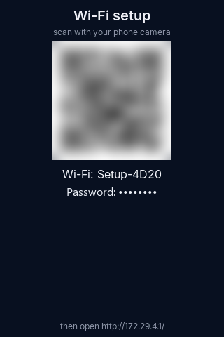

*The password and QR code are hidden in this picture. Yours are shown in full on the screen.*

**Headless board.** The OLED shows `SB20 SETUP`, the network name and a PIN. In your phone's WiFi
settings, join that network and use the PIN as the password.

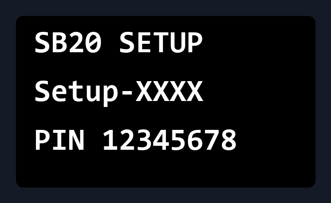

*An illustration of the text the OLED shows.*

**Both boards.** A setup page should open by itself. If it doesn't, go to `http://172.29.4.1/`. Pick
your home network, type its password and tap **Save & Connect**. The board restarts and joins your WiFi, and
shows its IP address on its display.

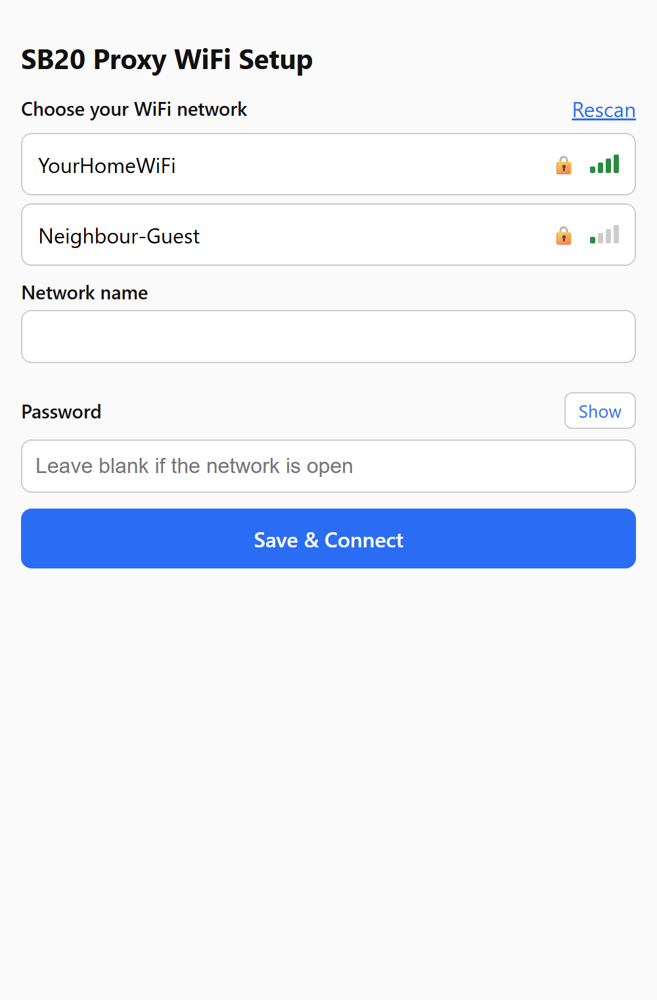

Bluetooth stays off while this setup network is up, so don't expect to find the board from a
Bluetooth app yet.

Put your phone back on your home WiFi before you carry on.

## 3. Choose your power meter

Spin the pedals first, so the meter wakes up.

*The screens in this guide come from a real board on a test bench with a simulated meter, which is
why the meter is named after a computer. You'll see your own meter's name.*

**Screen board.** Tap **Setup** on the bottom bar, then **Rescan**. Tap your meter in the list (it is
tagged `meter`), then **Save**. A `*` marks what you've picked. The board restarts. If you plan to run
workouts from the board, tap your trainer as well (tagged `trainer`) before you save.

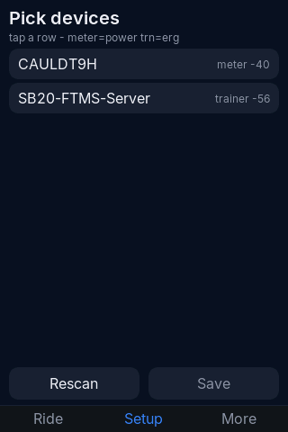

**Headless board.** Open `http://sb20proxy.local/setup`, or the IP address from the OLED in place of
`sb20proxy.local`. Tap **Scan** and pick your meter.

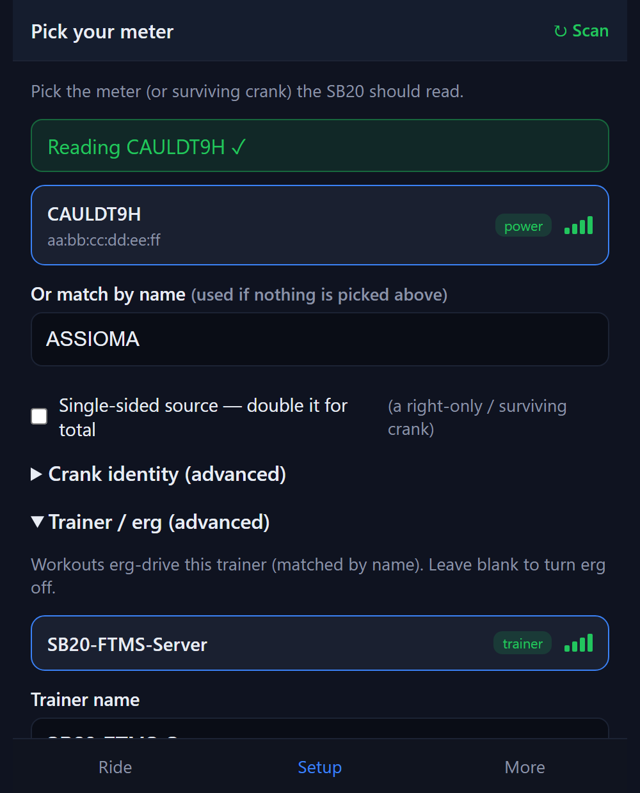

## 4. Set the crank identity

The SB20 looks for its crank by name, so **this is the step that most often stops pairing**, and it
fails silently. You do it on the web page, on either board:

1. Open `/setup` on your board's address.
2. If the meter you picked reports one leg only, tick **Single-sided source**. The board will double
   the reading.
3. Open **Crank identity (advanced)**. In **Crank name**, type the number you want the board to use,
   digits only, such as `62145`. The board adds the `Stages ` prefix for you.
4. Tap **Save**. The board restarts.

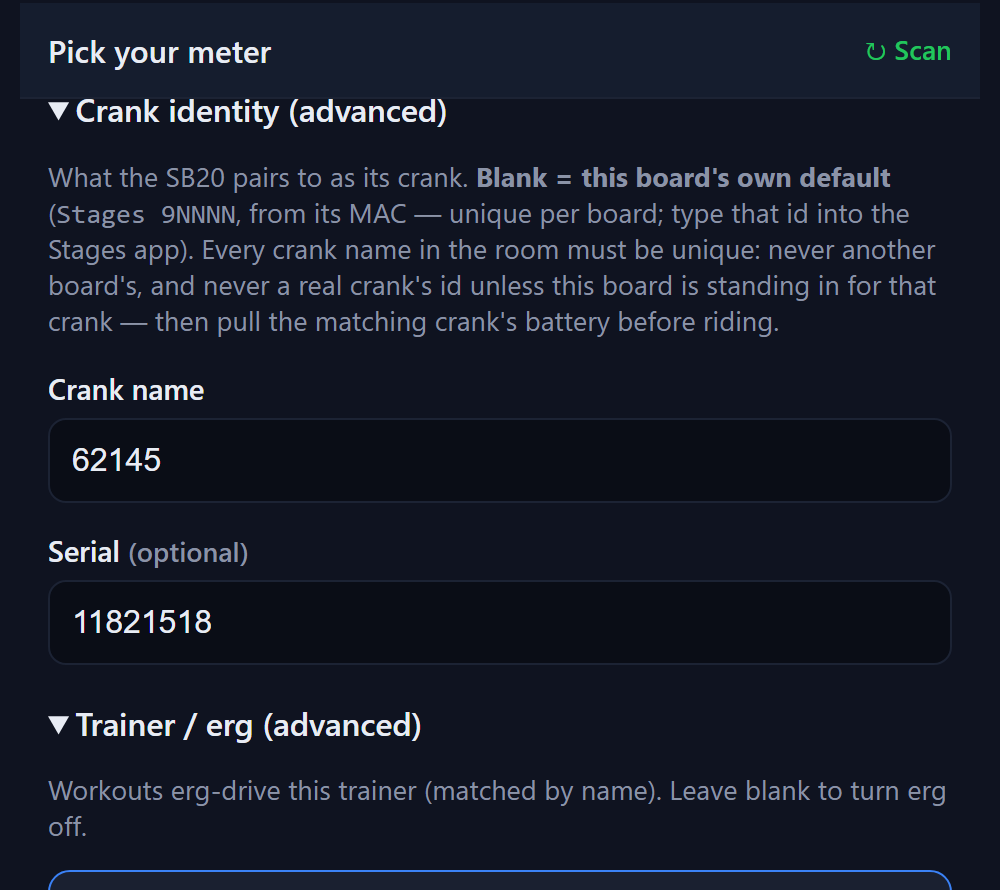

Don't leave **Crank name** blank. The board would then make up its own `Stages 9NNNN` name, and that
has never been tried against the Stages app on a real bike.

**Which number should you use?** Your real crank and the board can't both be the same crank at once,
so pick one of these:

- **Use a new number (the tested way).** Choose a number your bike doesn't already use, such as one
  more than your left crank's id, and set the bike's **left** crank to it in step 6. Leave your real
  cranks alone.
- **Stand in for your left crank.** Type your left crank's own number and take the battery out of
  that crank.

## 5. Check it before you touch the bike

Spin the pedals and watch the live numbers.

**Screen board.** The **Ride** screen shows your meter on the left of the top bar, then the crank
name the board is using. Green dots mean connected. Tap the top bar to see the input and output side
by side.

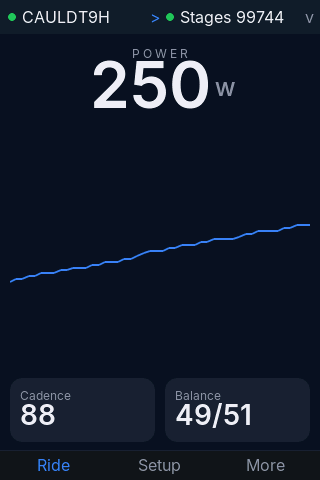 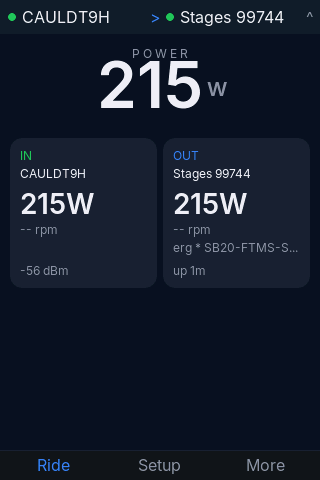

**Headless board.** Open `http://sb20proxy.local/`.

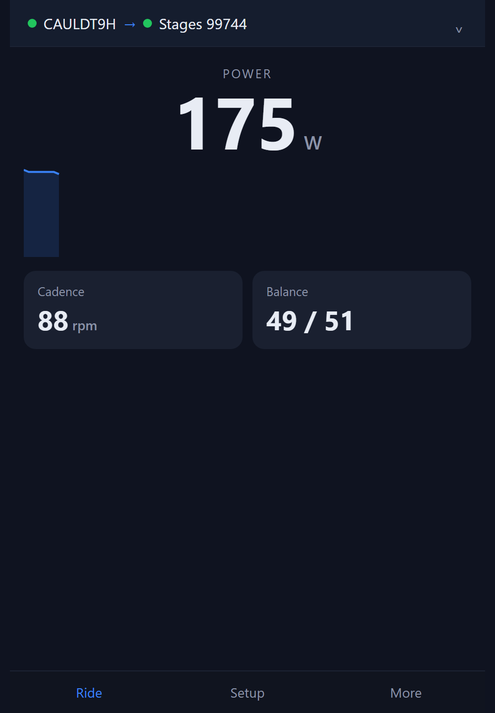

To double-check the details, open `/status` on your board's address:

| Field | What it should say |
|---|---|
| `version` | the version you installed |
| `identity` | `Stages` followed by your number |
| `identity_default` | `false` |
| `source` | `connected` while you are pedalling |

If the numbers look right here, go on. If not, sort it out now: nothing further will work until this
does.

## 6. Pair the bike

In the **Stages app**, set the bike's crank ids:

- **Left:** the number you gave the board.
- **Right:** your real right crank.

**Your real right crank has to be awake.** The bike needs to find both ids, or the app just says
pairing failed. Pedal to wake it, and fit a fresh CR2032 if it won't show up.

The first connection often drops and reconnects a moment later. That's normal.

When it works, the app shows power from your own meter.

## 7. Ride

**Screen board.** Leave it on the **Ride** screen.

**Headless board.** Keep `http://sb20proxy.local/` open on your phone, or just ride and use your
usual app. The board doesn't need to be watched.

## 8. Workouts and ERG

**Before anything else, set the bike's ride mode to `External` in the Stages app.** In `Grade` or
`Power/Erg`, the bike ignores outside targets, and an ERG workout will appear to do nothing.

Only one thing may control the bike at a time, so don't run a board workout and Zwift together.

**From Zwift or qz.** Use them as you normally would. This is the path that has been ridden on real
bikes.

**From the screen board.** Tap **More**, then **Workout**, and pick a workout. Tap **START**. You can
pause, skip or stop from the same screen.

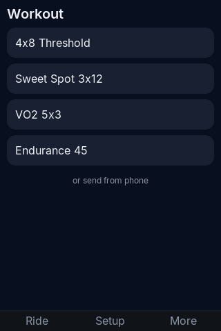 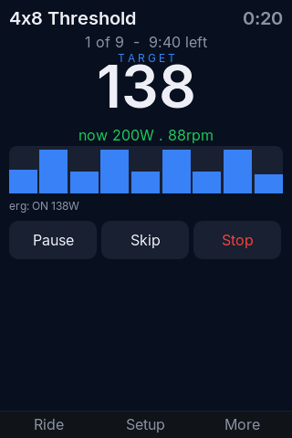

> Board-driven workouts are **new and have only been tested against a simulated trainer**. No SB20
> has been driven this way yet. Be ready to stop pedalling or tap **Stop**.

## 9. If something's wrong

| What you see | Try this |
|---|---|
| App says pairing failed | Wake your real right crank. Both ids must be findable. |
| Board shows power, but the bike doesn't | Check the crank number matches what's set in the app. It's a pairing problem, not a power problem. |
| `identity_default` is `true` | Your crank name didn't save. Enter it again in `/setup`. |
| ERG does nothing | Set the ride mode to `External` in the Stages app. |
| Your meter isn't in the list | Spin the pedals and scan again. |
| `sb20proxy.local` doesn't open | Use the IP address on the board's display. |
| The board went back to `Setup-XXXX` | It couldn't join your WiFi. Check the password and that the network is 2.4 GHz. |
| Screen is frozen | Unplug it, plug it back in, and tell us what you were doing. |

**Sending a report.** Open `/report` on your board's address. It shows exactly what would be sent,
which is your meter's Bluetooth data and the board's status. Tap **Download** and attach the file to a
[GitHub issue](https://github.com/cauldnz/SB20-power-proxy/issues). Nothing leaves the board unless
you do this.

Please don't try to debug on the bike. It's quicker to grab a report and send it in.
